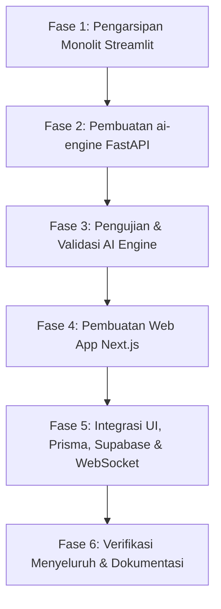

# Rework SiDetek-APD: Modern Decoupled Architecture (Next.js + Prisma/Supabase + FastAPI YOLOv11)

Transformasi menyeluruh aplikasi **SiDetek-APD** (Sistem Deteksi Alat Pelindung Diri K3 Konstruksi) dari arsitektur monolitik Python Streamlit menjadi arsitektur modern *decoupled microservices* (*Cloud-ready*, hemat memori, scalable, dan siap produksi).

---

## 1. Analisis Mendalam Codebase Eksisting

Berdasarkan inspeksi langsung terhadap file dan model di `c:\PersonalProject\SiDetek-APD`:

| Komponen | Status Saat Ini | Masalah / Bottleneck Utama |
|---|---|---|
| **Arsitektur** | Monolitik Python Streamlit (`app.py`, 536 baris) | Rerun model Streamlit memicu overhead komputasi; thread locking (`FrameSaveController`) rumit dan rentan deadlock saat streaming. |
| **Deteksi AI** | `helper.py` memuat `ultralytics.YOLO` langsung ke RAM UI | Menyatukan PyTorch/YOLO (RAM > 600MB) ke dalam UI web membuat aplikasi tidak bisa di-deploy gratis di platform seperti Vercel (serverless limit 250MB). |
| **Model Bobot** | `weights/model-deteksi-apd.pt` (40.5 MB) | Terlatih pada **2 kelas**: `Reflective-Jacket` (id 0) & `Safety-Helmet` (id 1). Inference CPU saat ini membutuhkan ~360ms per frame high-res. |
| **Webcam Streaming** | `streamlit_webrtc` dengan WebRTC peer-to-peer | Bergantung pada STUN/TURN Twilio eksternal; sering gagal handshake di jaringan terbatas (NAT/Firewall). |
| **Database & Media** | SQLite `ppe_detection_history.db` (`database.py`) | **Menyimpan file gambar langsung sebagai byte BLOB** di tabel database SQLite. Ini anti-pattern yang menyebabkan database membengkak cepat dan performa drop. |
| **Logika Bisnis K3** | Hanya kalkulasi frekuensi string label (`metric`) | Belum ada evaluasi kepatuhan APD (apakah pekerja berstatus **Lengkap / Patuh**, **Parsial**, atau **Pelanggaran / Tidak Patuh**). |

---

## 2. Arsitektur Target Baru (Decoupled Microservices)

```
c:\PersonalProject\SiDetek-APD\
├── ai-engine/                   # [Microservice AI] FastAPI + YOLOv11 (Deploy ke Render / Railway)
│   ├── app/
│   │   ├── api/v1/
│   │   │   ├── endpoints/
│   │   │   │   ├── detect.py    # POST /api/v1/detect (Image upload & inference)
│   │   │   │   └── stream.py    # WebSocket /api/v1/ws/stream (Realtime camera frames)
│   │   │   └── router.py
│   │   ├── core/
│   │   │   ├── config.py        # Environment settings (Pydantic Settings)
│   │   │   ├── compliance.py    # Evaluator K3 (Compliant vs Partial vs Violation)
│   │   │   └── yolo_engine.py   # YOLOv11 Singleton + ONNX runtime support
│   │   ├── schemas/
│   │   │   └── detection.py     # Schema Pydantic: BBox, DetectionResult, ComplianceReport
│   │   └── main.py              # FastAPI app, CORS middleware, Lifespan loader, Health check
│   ├── weights/
│   │   └── model-deteksi-apd.pt # Model weights YOLOv11
│   ├── Dockerfile               # Python 3.11-slim CPU-optimized Dockerfile
│   ├── render.yaml              # Infrastructure-as-Code blueprint untuk Render
│   └── requirements.txt         # FastAPI, Torch CPU, Ultralytics, Pillow, OpenCV-headless
│
└── fullstack/                   # [Web App K3] Next.js 14/15 + Tailwind + Prisma + Supabase
    ├── prisma/
    │   ├── schema.prisma        # Schema PostgreSQL (AuditLogs, DetectionRecords, BBoxes)
    │   └── migrations/
    ├── src/
    │   ├── app/
    │   │   ├── page.tsx         # Executive K3 Dashboard (KPI Kepatuhan, Statistik Pelanggaran)
    │   │   ├── detect/
    │   │   │   └── page.tsx     # Studio Deteksi: Tab Upload File & Tab Live Webcam (Canvas Overlay)
    │   │   ├── history/
    │   │   │   └── page.tsx     # Riwayat Audit, Filter Status Kepatuhan, Modal Detail & Hapus
    │   │   ├── analytics/
    │   │   │   └── page.tsx     # Visualisasi Tren K3 & Distribusi Penggunaan APD
    │   │   └── api/
    │   │       ├── detect/      # API Route Handler (Next.js -> AI Engine -> Supabase)
    │   │       └── history/     # API Route Handler untuk CRUD audit
    │   ├── components/
    │   │   ├── ui/              # Button, Card, Badge, Modal, Tabs, StatCards
    │   │   ├── ImageDetector.tsx# Dropzone upload + SVG/Canvas Interactive Bounding Box
    │   │   ├── WebcamDetector.tsx # HTML5 Camera + WebSocket to AI Engine + Canvas BBox rendering
    │   │   ├── ComplianceBadge.tsx# Badge status kepatuhan K3 (Hijau/Kuning/Merah)
    │   │   └── Navbar.tsx       # Navigasi modern dengan logo & active route indicator
    │   └── lib/
    │       ├── prisma.ts        # Prisma Client singleton
    │       ├── supabase.ts      # Supabase Storage client untuk upload gambar
    │       └── ai-client.ts     # Client HTTP & WS penghubung ke ai-engine
    ├── package.json
    ├── tailwind.config.ts
    └── .env.example
```

---

## User Review Required

> [!NOTE]
> Sesuai arahan user: Folder `legacy-streamlit` tidak diperlukan. File monolit Streamlit lama (`app.py`, `helper.py`, `database.py`, `settings.py`, `ppe_detection_history.db`, `.streamlit/`) akan dibersihkan dari root, dan seluruh fungsionalitas dialihkan ke arsitektur `ai-engine` + `fullstack`.

> [!IMPORTANT]
> **2. Penanganan Database & Media Gambar:**
> Berbeda dari kode lama yang menyimpan gambar biner (BLOB) di dalam SQLite, arsitektur baru memisahkan penyimpanan:
> - **File Gambar:** Disimpan di object storage (Supabase Storage bucket `ppe-audit-images` atau local storage fallback jika offline).
> - **Metadata & Anotasi:** Disimpan di database PostgreSQL melalui Prisma ORM (hanya menyimpan URL gambar, koordinat BBox, tingkat kepercayaan, dan status kepatuhan).

> [!WARNING]
> **3. Environment Windows & Script Execution:**
> Pada terminal Windows PowerShell, eksekusi perintah NPM memerlukan `npm.cmd` dan `npx.cmd` karena script policy `npm.ps1` dibatasi oleh Windows. Kode & tooling otomatis akan menggunakan `.cmd`.

---

## Open Questions

> [!NOTE]
> Mohon pertimbangkan pertanyaan berikut sebelum atau saat eksekusi:
> 1. **Penyimpanan Database Utama**: Apakah Anda sudah memiliki akun **Supabase** (PostgreSQL) yang ingin langsung dihubungkan melalui `DATABASE_URL` dan `SUPABASE_URL`, atau kita siapkan skema Prisma dengan dukungan SQLite lokal terlebih dahulu untuk pengembangan offline sebelum beralih ke PostgreSQL Supabase?
> 2. **Ekspor Model ONNX**: Apakah Anda ingin menyertakan skrip otomatis konversi `model-deteksi-apd.pt` ke format ONNX (`model-deteksi-apd.onnx`) untuk meningkatkan kecepatan inferensi CPU hingga 2x lipat dan menghemat memori container di Render?

---

## Proposed Changes

### Component 1: Pembersihan Kode Streamlit Monolitik Lama
Menghapus file monolitik Streamlit lama dari root repository (`app.py`, `helper.py`, `database.py`, `settings.py`, `ppe_detection_history.db`, `packages.txt`, `runtime.txt`, `.streamlit/`) karena seluruh fungsionalitasnya telah dirancang ulang ke dalam `ai-engine/` dan `fullstack/`.

#### [MODIFY] [README.md](file:///c:/PersonalProject/SiDetek-APD/README.md)
Memperbarui README root untuk mendeskripsikan arsitektur decoupled modern (`ai-engine/` dan `fullstack/`).

---

### Component 2: Microservice AI Engine (`ai-engine/`)

#### [NEW] [ai-engine/requirements.txt](file:///c:/PersonalProject/SiDetek-APD/ai-engine/requirements.txt)
Dependensi Python teroptimasi CPU:
- `fastapi>=0.111.0`
- `uvicorn[standard]>=0.30.0`
- `python-multipart>=0.0.9`
- `pydantic>=2.7.0`
- `pydantic-settings>=2.2.0`
- `ultralytics>=8.2.0`
- `torch>=2.2.0` (CPU build)
- `torchvision>=0.17.0` (CPU build)
- `opencv-python-headless>=4.9.0.80`
- `pillow>=10.3.0`
- `websockets>=12.0`
- `onnxruntime>=1.18.0`

#### [NEW] [ai-engine/app/core/config.py](file:///c:/PersonalProject/SiDetek-APD/ai-engine/app/core/config.py)
Konfigurasi aplikasi via Pydantic: port, CORS origins (mengizinkan `http://localhost:3000` dan production URL Vercel), path bobot model, default threshold, dll.

#### [NEW] [ai-engine/app/core/compliance.py](file:///c:/PersonalProject/SiDetek-APD/ai-engine/app/core/compliance.py)
Mesin aturan kepatuhan K3:
- Menghitung jumlah `Safety-Helmet` dan `Reflective-Jacket`.
- Melakukan evaluasi spasial: apakah helm berada di atas rompi pekerja yang sama.
- Menentukan status akhir:
  - `COMPLIANT`: Semua pekerja memakai helm dan rompi.
  - `PARTIAL`: Pekerja hanya memakai salah satu (helm saja atau rompi saja).
  - `NON_COMPLIANT`: Tidak terdeteksi APD standar.

#### [NEW] [ai-engine/app/core/yolo_engine.py](file:///c:/PersonalProject/SiDetek-APD/ai-engine/app/core/yolo_engine.py)
Singleton wrapper untuk YOLOv11:
- Memuat model sekali pada saat startup (lifespan).
- Metode inferensi untuk input PIL Image atau bytes.
- Ekstraksi koordinat BBox ternormalisasi `[0..1]` dan absolut `[x1, y1, x2, y2]`.
- Gambar hasil anotasi (annotated frame).

#### [NEW] [ai-engine/app/schemas/detection.py](file:///c:/PersonalProject/SiDetek-APD/ai-engine/app/schemas/detection.py)
Pydantic model:
- `BoundingBox`: x1, y1, x2, y2, norm_x1, norm_y1, norm_x2, norm_y2.
- `DetectedObject`: class_id, label, confidence, bbox.
- `ComplianceReport`: status (`COMPLIANT`, `PARTIAL`, `NON_COMPLIANT`), helmet_count, jacket_count, compliance_score (0-100), message.
- `DetectionResponse`: inference_time_ms, image_width, image_height, objects, compliance, annotated_image_base64 (optional).

#### [NEW] [ai-engine/app/api/v1/endpoints/detect.py](file:///c:/PersonalProject/SiDetek-APD/ai-engine/app/api/v1/endpoints/detect.py)
REST endpoint:
- `POST /api/v1/detect`: Menerima upload file gambar, ambang batas confidence (default 0.35), opsi output anotasi. Mengembalikan `DetectionResponse`.

#### [NEW] [ai-engine/app/api/v1/endpoints/stream.py](file:///c:/PersonalProject/SiDetek-APD/ai-engine/app/api/v1/endpoints/stream.py)
WebSocket endpoint:
- `WS /api/v1/ws/stream`: Menerima frame webcam (base64 / JPEG bytes) dari frontend, melakukan inferensi cepat, dan mengembalikan array BBox + status K3 dalam <50ms tanpa overhead HTTP handshake.

#### [NEW] [ai-engine/app/main.py](file:///c:/PersonalProject/SiDetek-APD/ai-engine/app/main.py)
FastAPI entrypoint:
- Registrasi CORS untuk frontend Next.js.
- Lifespan context manager untuk pre-load model.
- Endpoint `GET /health` untuk liveness monitor di Render/Cloud.

#### [NEW] [ai-engine/Dockerfile](file:///c:/PersonalProject/SiDetek-APD/ai-engine/Dockerfile)
Multi-stage build Python 3.11-slim, instalasi `libgl1` dan `libglib2.0-0`, PyTorch CPU wheel, expose port 8000.

#### [NEW] [ai-engine/render.yaml](file:///c:/PersonalProject/SiDetek-APD/ai-engine/render.yaml)
Blueprint IaC untuk 1-click deploy ke platform cloud Render (Singapore region, free web service).

#### [NEW] [ai-engine/weights/model-deteksi-apd.pt](file:///c:/PersonalProject/SiDetek-APD/ai-engine/weights/model-deteksi-apd.pt)
Salinan bobot model APD dari folder weights lama.

---

### Component 3: Modern Web Application (`fullstack/`)

#### [NEW] `fullstack/package.json`
Inisialisasi aplikasi Next.js (App Router, TypeScript, Tailwind CSS, `@prisma/client`, `@supabase/supabase-js`, `lucide-react`, `clsx`, `tailwind-merge`).

#### [NEW] [fullstack/prisma/schema.prisma](file:///c:/PersonalProject/SiDetek-APD/fullstack/prisma/schema.prisma)
Model database:
- `AuditLog`: id, createdAt, source (`UPLOAD` / `WEBCAM`), originalImageUrl, annotatedImageUrl, complianceStatus (`COMPLIANT` / `PARTIAL` / `NON_COMPLIANT`), helmetCount, vestCount, notes.
- `DetectedObject`: id, auditLogId, label, confidence, x1, y1, x2, y2.

#### [NEW] [fullstack/src/lib/prisma.ts](file:///c:/PersonalProject/SiDetek-APD/fullstack/src/lib/prisma.ts)
Prisma Client singleton untuk Next.js server runtime.

#### [NEW] [fullstack/src/lib/supabase.ts](file:///c:/PersonalProject/SiDetek-APD/fullstack/src/lib/supabase.ts)
Helper upload gambar ke Supabase Storage bucket `ppe-audit-images` dengan fallback ke local public directory jika credential belum diisi.

#### [NEW] [fullstack/src/lib/ai-client.ts](file:///c:/PersonalProject/SiDetek-APD/fullstack/src/lib/ai-client.ts)
Helper pemanggilan API FastAPI (`detectImage` dan WebSocket provider).

#### [NEW] [fullstack/src/app/page.tsx](file:///c:/PersonalProject/SiDetek-APD/fullstack/src/app/page.tsx)
Dashboard Eksekutif K3:
- Ringkasan KPI: Tingkat Kepatuhan (%), Total Inspeksi APD, Total Pelanggaran Helm, Total Pelanggaran Rompi.
- Card Quick Action ke Halaman Deteksi.
- Tabel Audit Terbaru dengan badge status kepatuhan visual.

#### [NEW] [fullstack/src/app/detect/page.tsx](file:///c:/PersonalProject/SiDetek-APD/fullstack/src/app/detect/page.tsx)
Studio Deteksi APD:
- Pengaturan Threshold Confidence slider interaktif.
- Tab 1: Unggah Gambar statis (Drag & Drop, preview gambar, visualisasi BBox interaktif, ringkasan kepatuhan K3, tombol simpan audit ke database).
- Tab 2: Live Webcam Detection (Akses kamera browser via HTML5 getUserMedia, streaming frame via WebSocket ke AI Engine, rendering BBox realtime menggunakan HTML5 Canvas di atas video).

#### [NEW] [fullstack/src/components/ImageDetector.tsx](file:///c:/PersonalProject/SiDetek-APD/fullstack/src/components/ImageDetector.tsx)
Komponen upload gambar dengan SVG/Canvas Bounding Box overlay responsif (kotak hijau untuk helm, kuning untuk rompi).

#### [NEW] [fullstack/src/components/WebcamDetector.tsx](file:///c:/PersonalProject/SiDetek-APD/fullstack/src/components/WebcamDetector.tsx)
Komponen webcam interaktif:
- Start / Stop kamera.
- FPS counter & latency tracker.
- Tombol snapshot untuk menyimpan frame saat ini ke log audit K3.

#### [NEW] [fullstack/src/app/history/page.tsx](file:///c:/PersonalProject/SiDetek-APD/fullstack/src/app/history/page.tsx)
Halaman Audit Riwayat Deteksi:
- Filter berdasarkan status kepatuhan (`Semua`, `Patuh`, `Parsial`, `Melanggar`).
- Filter rentang tanggal.
- Kartu / Tabel inspeksi dengan thumbnail gambar sebelum dan sesudah deteksi.
- Modal detail inspeksi lengkap beserta koordinat BBox dan waktu inferensi.
- Aksi hapus rekaman audit.

#### [NEW] [fullstack/src/app/analytics/page.tsx](file:///c:/PersonalProject/SiDetek-APD/fullstack/src/app/analytics/page.tsx)
Halaman Analisis & Tren:
- Grafik persentase kepatuhan harian/mingguan.
- Rasio kelengkapan helm vs rompi reflektif.
- Rekomendasi tindakan keselamatan kerja otomatis.

---

## 3. Rencana Eksekusi Bertahap (Execution Phases)



1. **Fase 1: Pengarsipan Monolit Streamlit (`legacy-streamlit/`)**
   - Buat direktori `legacy-streamlit/` dan pindahkan file lama dengan aman.
   - Perbarui `README.md`.
2. **Fase 2: Pembangunan `ai-engine/` (FastAPI + YOLOv11)**
   - Siapkan struktur modul `ai-engine/app/`.
   - Implementasikan Pydantic schemas, YOLO engine loader, aturan evaluasi kepatuhan K3, endpoint REST `detect`, dan endpoint WebSocket `stream`.
   - Siapkan `Dockerfile` dan `render.yaml`.
3. **Fase 3: Pengujian & Validasi AI Engine**
   - Uji inferensi lokal menggunakan Python 3.11 dan file contoh `assets/testing-apd-gundar5.jpg`.
   - Pastikan response JSON valid dan evaluasi K3 akurat.
4. **Fase 4: Pembangunan Web App `fullstack/` (Next.js)**
   - Inisialisasi struktur Next.js App Router, Tailwind CSS, TypeScript, dan Prisma schema.
   - Bangun komponen UI reusable (Button, Card, Badge, Modal, Navbar).
5. **Fase 5: Integrasi Komponen & Fitur Lengkap**
   - Halaman Dashboard K3 (`/`).
   - Studio Deteksi (`/detect`) dengan Image Upload & Live Webcam Canvas Overlay.
   - Halaman Audit Riwayat (`/history`) & Analisis (`/analytics`).
   - Integrasi Prisma & Supabase Storage.
6. **Fase 6: Verifikasi Menyeluruh & Panduan Deployment**
   - Jalankan build test `npm.cmd run build`.
   - Pastikan dokumentasi cara deploy terperinci di README.

---

## Verification Plan

### Automated Verification

1. **Verifikasi AI Engine:**
   - Jalankan skrip uji inferensi FastAPI:
     ```powershell
     py -3.11 ai-engine/test_inference.py
     ```
   - Verifikasi status HTTP 200 dari endpoint `/health`:
     ```powershell
     py -3.11 -c "import urllib.request; print(urllib.request.urlopen('http://localhost:8000/health').read().decode())"
     ```
   - Verifikasi deteksi objek pada `testing-apd-gundar5.jpg` (harus mendeteksi `Safety-Helmet` dan `Reflective-Jacket` dengan status kepatuhan).

2. **Verifikasi Fullstack Web App:**
   - Validasi skema Prisma:
     ```powershell
     cd fullstack; npx.cmd prisma validate
     ```
   - Validasi TypeScript & Next.js Build:
     ```powershell
     cd fullstack; npm.cmd run build
     ```

### Manual Verification

1. **Uji Upload Gambar:**
   - Buka `http://localhost:3000/detect`.
   - Unggah gambar pekerja di zona konstruksi.
   - Periksa apakah bounding box digambar secara tepat di atas gambar asli dan status kepatuhan K3 ditampilkan (Lengkap / Parsial / Pelanggaran).
   - Klik "Simpan ke Riwayat Audit", pastikan data muncul di halaman `/history`.

2. **Uji Realtime Webcam:**
   - Buka tab "Live Webcam" pada `http://localhost:3000/detect`.
   - Klik "Mulai Kamera", izinkan akses webcam.
   - Amati canvas overlay real-time yang menggambar bounding box APD dengan latency responsif (<100ms).
   - Uji tombol "Simpan Frame Snapshot".

3. **Uji Riwayat & Filter Audit:**
   - Buka `http://localhost:3000/history`.
   - Uji filter status (Semua, Patuh, Pelanggaran).
   - Buka modal detail audit untuk melihat koordinat BBox dan statistik APD.
   - Uji penghapusan record riwayat audit.
